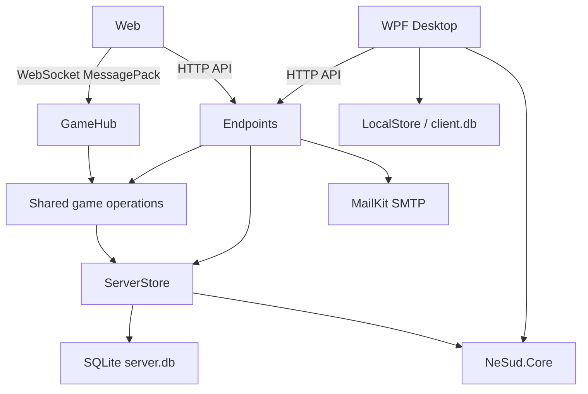

# Архітектура та карта вихідного коду

Документація описує реалізовану систему станом на зміни UX 27.11.2026. Детальні правила й запуск: [PROJECT.md](PROJECT.md). Вихідний код є остаточним джерелом істини.

## Компоненти

| Компонент | Відповідальність |
|---|---|
| NeSud.Core | Контракти, Game, Puzzle, Sudoku, LogicalSolver, ChallengeRules, AppState та сумісність старих збережень |
| NeSud.Storage | Database, LocalStore, SQLite, локальні scope, історія, pending-черга |
| NeSud.Server | ASP.NET Core, HTTP API, SignalR, серверна історія, акаунти, SMTP, нагороди |
| NeSud | WPF .NET 10 для Windows, незалежна офлайн-гра, серверні щоденні ігри |
| wwwroot | HTML/CSS/JS без SPA-фреймворку; локальні npm-бібліотеки SignalR |
| NeSud.SmokeTests | Консольні регресійні сценарії Core/Storage/Server |

## Сервер

Program.cs налаштовує конфігурацію, singleton ServerStore, обмеження HTTP body 8 МіБ, rate limit auth 10 запитів/хв на IP, CSP, статичні файли та Hub. SignalR: WebSocket only, MessagePack only, 16 КіБ на вхідне повідомлення, буфери по 32 КіБ, один виклик на з'єднання, keep-alive 15 с, timeout 30 с.

Endpoints/AccountEndpoints: реєстрація, логін, вихід, налаштування, верифікація, аватар, health. PlayerEndpoints: профілі, пошук, дружба, історія, desktop sync/drafts, рейтинги. RewardEndpoints: гаманці, призові набори, календар і турніри. GameEndpoints: snapshot, observe, new, move; авторитетна логіка для REST та Hub. Sessions: серверний стан гри та DTO команд. Realtime/GameHub: Subscribe, Snapshot, Observe, New, Move, WatchRankings; Wire перетворює JSON-сумісні DTO у MessagePack-мапи та дельти полів. Токен перевіряється на захищених викликах. Групи акаунта не використовують змінний нікнейм як ключ.

Persistence: AccountStore (секрети, токени), IdentityStore (профіль, email, invite, PNG), FriendStore, HistoryStore, ProfileStore, RankingStore, SessionStore, DailyStore, ChallengeStore, TournamentStore; усі partial одного ServerStore. Gate серіалізує критичні зміни у процесі. Не дублювати правила в endpoints або UI.

## Сховище

Серверні таблиці:

| Таблиця | Призначення / інваріант |
|---|---|
| accounts | Незмінний ідентифікатор, salt/hash |
| account_profiles | Змінний username, email, статус, код запрошення, аватар |
| tokens | Хеш токена та термін дії |
| referral_rewards | Одноразове зарахування верифікованого запрошеного |
| history | Єдина історія звичайних і щоденних ігор; ключ акаунт + UUID |
| web_sessions | Поточна звичайна серверна гра |
| speed_audit | Внутрішній аудит швидкості; не публікується |
| daily_packs | Збережені варіанти карток і вибір |
| wallet | Невід'ємний баланс за видом ресурсу |
| wallet_spends | Ідемпотентне списання за UUID |
| tournament_state | Наступний тиждень для закриття |
| tournament_results | Зафіксовані місця та результати |
| friendships | Напрямлений запит або прийнятий зв'язок |
| challenge_difficulties | Складність фіксується до генерації |
| challenge_puzzles | Одна головоломка на дату |
| challenge_sessions | Сеанс акаунта на дату |
| challenge_wins | Єдина зарахована перемога акаунта на дату |
| monthly_cups | Один кубок акаунта на місяць |
| desktop_drafts | Резервні копії поточних офлайн-ігор |

Тригер immutable_invite забороняє зміну коду. Індекси підтримують пошук за акаунтом, рівнем, датою, рейтингом, строком токена, вхідними дружніми запитами та невибраними наборами. Локальні settings і history містять стан WPF, scope та pending; старий JSON імпортується один раз. Міграції повинні бути повторюваними та транзакційними, без втрати історії.

## Web

Скрипти класичні, deferred, порядок визначає index.html. state.js: спільні змінні та REST; realtime.js: з'єднання, авторизація, інвалідація, дельти; account.js: сесія та перехід акаунта; session.js: серверна гра й heartbeat; board.js: ввід; rewards.js: нагороди; results.js: результати та анімації; render.js: відображення ігрового стану; navigation.js: маршрути та таблиці; profile.js / profile-edit.js: публічний профіль і налаштування; calendar.js: дати; friends.js: соціальні функції; help.js: довідка; dialogs.js: закриття; startup.js: запуск.

Не викликати функції інших скриптів на верхньому рівні до їх завантаження. Після await перевіряти epoch, акаунт і маршрут, перш ніж змінювати UI. Не повторювати невизначену мережеву команду автоматично. Ревізії перевіряють зміну ігрового стану, але не є глобальною ревізією акаунта.

## Desktop

MainWindow partial: Layout (спільна шапка та UI), Rendering (Render, результат, анімації), Presentation (компактні показники й рядки), Input (клавіатура), Gameplay (ходи), GameLifecycle (генерація/збереження), Connection (API та sync), Account, Profile, ProfileEdit, PlayerIdentity, Friends, Statistics, ChallengeCalendar, ChallengeGame, Rewards, Help, Dialogs, Surfaces. App.xaml містить тематичні WPF styles. InAppSurface зберігає сумісність синхронних сценаріїв через DispatcherFrame. Шапка живе поза контейнером сторінок; модальні діалоги тимчасово блокують її. Не створювати новий Window для звичайної сторінки.

Повернення додому повинно проходити через Closing; у щоденній грі потрібна серверна пауза. homeNavigationVersion запобігає повторному відкриттю календаря. Не обходити цей механізм ForceClose, окрім остаточного закриття процесу. Результат асинхронного запиту не повинен відкривати сторінку після зміни акаунта або маршруту.

## Мережеві межі

Web і Desktop мають різні поточні звичайні ігри. Збереження Desktop синхронізуються ідемпотентно; чернетка іншого клієнта поки лише відображається. Щоденний сеанс спільний для акаунта і дати. SignalR застосований до Web, Desktop ще використовує REST. Серверні пульси активної гри потрібні навіть при транспортному keep-alive. Observe не продовжує ігровий таймер. Немає горизонтального масштабування, гарантованої доставки push після довгого розриву або реального античиту для офлайн-гри.
